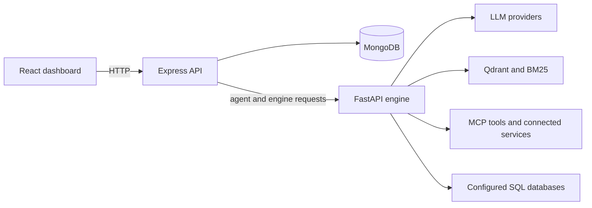

# Sigil AI Atelier

Sigil AI Atelier is a multi-service workspace for configuring AI agents, connecting model providers and tools, and working with knowledge bases and SQL databases. The application combines a React dashboard, an Express API backed by MongoDB, and a Python FastAPI engine for model and agent workflows.

> The Python engine currently identifies itself as “Yakkay AI Engine” in its API metadata. The dashboard and engine are part of this repository.

## What it includes

- A dashboard for agent setup, provider connections, and interactive agent runs.
- A Node.js/Express API for authentication, users, agents, connections, knowledge bases, and public agent endpoints.
- A Python/FastAPI engine for model operations, agent execution, document ingestion, and database schema/query workflows.
- MCP tool integrations, including Google and Microsoft OAuth-backed features.
- Hybrid knowledge retrieval using Qdrant and BM25, with document parsing and reranking components.
- SQL database connections and customizable dashboard themes.

## Architecture



## Repository layout

| Path | Purpose |
| --- | --- |
| `frontend/` | React dashboard |
| `backend/` | Express API, MongoDB models, routes, and OAuth handlers |
| `ai_engine/` | FastAPI service and agent/model orchestration |
| `AI_Platform_MCP/` | MCP server and tool implementations |
| `backend/diagrams/` | Workflow diagrams |

## Run locally

### Prerequisites

- Node.js and npm
- Python and pip
- A reachable MongoDB instance
- Provider credentials for the model and integrations you intend to use

### 1. Configure the backend

Create `backend/.env` and set the values needed for your local setup:

```dotenv
PORT=5000
MONGO_URI=mongodb://127.0.0.1:27017/yakkay-ai
JWT_SECRET=replace-with-a-long-random-secret
ENCRYPTION_KEY=replace-with-a-separate-secret
BACKEND_URL=http://localhost:5000
```

Keep secrets private, use distinct strong values for `JWT_SECRET` and `ENCRYPTION_KEY`, and use the same `ENCRYPTION_KEY` for the backend and AI engine. Google and Microsoft OAuth credentials and redirect URIs are optional and are needed only for those integrations. The backend reads `Gmail_ClientID`, `Gmail_ClientSecret`, `Gmail_REDIRECT_URI`, `MS_ClientID`, `MS_SecretID`, and `MS_REDIRECT_URI` when those integrations are enabled.

In a terminal:

```powershell
cd backend
npm install
npm start
```

The API listens on port `5000` by default. MongoDB must be available at the configured URI.

### 2. Configure and run the AI engine

Create `ai_engine/.env` for the credentials and connection settings required by the features you plan to use. Common settings include:

```dotenv
GEMINI_API_KEY=your-provider-key
GOOGLE_API_KEY=your-google-api-key
MONGO_URI=mongodb://127.0.0.1:27017/yakkay-ai
ENCRYPTION_KEY=the-same-value-as-backend
```

Create a virtual environment, install dependencies, and start the service:

```powershell
cd ai_engine
py -m venv .venv
.\.venv\Scripts\Activate.ps1
python -m pip install -r requirements.txt
python main.py
```

The engine listens on port `8000` by default. On macOS or Linux, activate the environment with `source .venv/bin/activate`.

### 3. Start the dashboard

In another terminal:

```powershell
cd frontend
npm install
npm start
```

The development server opens at `http://localhost:3000`. The current frontend calls the backend at `http://localhost:5000`; keep that address available when using the dashboard locally.

## Configuration notes

- Do not commit `.env` files or provider credentials.
- Set `JWT_SECRET` explicitly; do not rely on the backend's development fallback for a deployed environment.
- Configure provider credentials only for the models and integrations you use. OAuth redirect URIs must match the values registered with the corresponding provider.
- Local knowledge indexes and database connections are managed by the AI engine; retain the engine's data directory if you need its local indexes to persist.

For prioritized follow-up work, see the [optimization roadmap](plan.md).

## Development

The frontend provides the `start`, `test`, and `build` npm scripts. The backend provides `start` and `dev` scripts; its current `test` script is a placeholder. The Python dependency lists are in `ai_engine/requirements.txt` and `AI_Platform_MCP/requirements.txt`.

## License

No repository-level license file is currently provided. Check with the project maintainers before redistributing or reusing the code.
